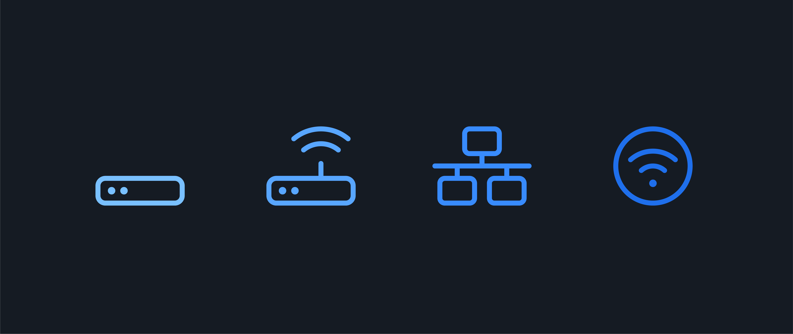

<h1>
  Describe Your Home Network
  Home Network Discussion
</h1>

**Learning objective:** By the end of this lesson, students will be able to describe potential improvements they could make to their home network and how those improvements relate to the broader principles of networking.

## Identifying the components of your home network

To begin our exploration, let's take a moment to identify the key components that make up your home network. These components work together to enable connectivity, share resources, and provide access to the internet.

1. **Modem**: The modem is the device that connects your home network to the internet service provider (ISP). It converts the signal from your ISP into a form your devices can understand.

   The modem is your local network's gateway to the internet, allowing you to send and receive data from the outside world.

2. **Router**: The router is the central hub of your home network. It connects to the modem and creates a local area network (LAN) for your devices to communicate with each other and access the internet. In many home networks, the modem and router are combined into a single device.

   Imagine the router as the traffic controller of your network, directing data packets to their intended destinations and ensuring smooth communication between devices.

3. **Ethernet switches**: Ethernet switches allow you to expand the number of wired devices connected to your network. They provide additional Ethernet ports and help manage data flow between devices.

   Think of Ethernet switches as the expansion packs for your network, allowing you to connect more wired devices and create a larger, more robust network. Home networks often don't require switches and can rely on the router's or modem's built-in ports.

4. **Wireless access points (WAPs)**: Wireless access points enable wireless devices to connect to your network. They broadcast a Wi-Fi signal that devices can detect and use to establish a connection.

   WAPs are the wireless expansion packs of your network. Like ethernet switches, they have a maximum number of devices they can support. However, proximity and environmental factors can impact their performance.

   Many modems and routers have built-in WAPs, but you can add standalone WAPs to extend your network's wireless coverage.

5. **End devices**: End devices are the devices that you use to access the network and its resources. These include computers, laptops, smartphones, tablets, smart TVs, and more.

   Treat end devices as the travelers on your network, each with a unique destination and purpose, but all relying on the network infrastructure to reach their destinations.

  <h3 class="title">What's your network's infrastructure?</h3>
  5 min

Now that we've identified the main components of a home network take a moment to think about the infrastructure of your home's network.

We'll discuss some of these points:

- Does your network have a single modem/router combo?
- Does your modem or router also have a built-in wireless access point?
- Do you have additional switches or access points to extend your network's coverage?

## Analyzing your home network

With a better understanding of your network's components, let's dive deeper into analyzing its performance and identifying potential areas for improvement.

1. **Network topology:** Observe how your devices are connected to the network. Are they primarily connected wirelessly or through Ethernet cables? How are the devices arranged in relation to the router and switches?

   Consider your network's topology as a the map showing how your devices are interconnected. Different topologies can impact performance, scalability, and ease of management.

2. **Bandwidth and speed:** Test your network's internet speed and bandwidth using online tools like [Cloudflare Speed Test](https://speed.cloudflare.com/). Compare the results to your ISP's advertised speeds and your plan's limits.

   Think of bandwidth as the width of the road that data travels on. The wider the road (higher the bandwidth), the more data can pass through simultaneously, resulting in faster speeds.

3. **Wireless coverage:** Assess the wireless coverage of your network by testing the Wi-Fi signal strength in different areas of your home. Identify any dead spots or areas with weak signal strength.

   Imagine wireless coverage as the reach of your network's invisible tentacles. The stronger and farther-reaching the tentacles (signal), the better the connectivity and performance in different areas of your home.

4. **Security settings:** Review your network's security settings, including the encryption type (for example, WPA2), password strength, and firewall settings. Ensure that your network is properly secured to protect against unauthorized access.

   Security settings are the guardians of your network, protecting your data and devices from intruders. The stronger the guards (encryption and passwords), the safer your network.

5. **Device performance:** Observe the performance of your devices when connected to the network. Are there any devices that consistently experience slow speeds or connectivity issues?

   Consider device performance as the individual experience of each traveler on your network. Some devices may encounter roadblocks or detours that slow them down, while others cruise along smoothly.

  <h3 class="title">Audit your network's performance</h3>
  2 min

Take a moment to think about your home's network performance. Identify one or two areas where your network could be improved. These insights will be valuable as we move on to the next step.

## Identifying potential improvements

Now that you've analyzed your home network, let's explore potential improvements to enhance its performance, security, and overall functionality.

1. **Bandwidth upgrades:** If your internet speed consistently falls below your ISP's advertised speeds or your plan's limits, consider upgrading your bandwidth. Contact your ISP to discuss available options and pricing.

   Think of a bandwidth upgrade as widening the road that data travels on. With a wider road, more data can pass through simultaneously, resulting in faster speeds and better performance.

2. **Router placement:** If your router also acts as a WAP, experiment with different router placements to optimize wireless coverage. Place the router in a central location, away from obstacles and interference sources like walls, metal objects, and electronic devices.

   Router placement is the strategic positioning of your network's command center. The more central and unobstructed the location, the better the wireless signals can reach every corner of your home.

3. **Upgrade your router:** If your router is outdated, consider upgrading to a newer model that supports the latest Wi-Fi standards (for example, Wi-Fi 6 or 7) for better performance and coverage.

   Upgrading your router acts as giving your network a new, faster engine. The latest models can handle more devices and provide better speeds.

4. **Mesh network:** If you have a large home or multiple floors, consider setting up a mesh network to improve wireless coverage and eliminate dead spots.

   Think of a mesh network as a team of relay runners, passing the signal baton to ensure seamless coverage throughout your home.

5. **Regular maintenance:** Periodically restart your modem and router to ensure optimal performance. Also, keep your devices' firmware up to date.

   Imagine regular maintenance as giving your network a refreshing nap. A quick restart can clear out any cobwebs and keep things running smoothly.

6. **Wireless channel optimization:** If you experience slow wireless speeds or interference, consider changing the wireless channel on your router. You can use Wi-Fi analyzer tools to identify the least congested channel in your area.

   Think of wireless channels as the lanes on the data highway. Choosing a less congested lane (channel) can avoid traffic jams and ensure smoother, faster data flow. If you have multiple WAPs, ensure they are set to different channels to avoid interference.

7. **Quality of Service (QoS) settings:** Explore QoS settings on your router to prioritize certain types of network traffic, such as video conferencing or gaming. This can help ensure a better experience for critical applications.

   Consider QoS settings as the traffic police of your network, giving priority to important vehicles (applications) and ensuring they reach their destinations quickly and smoothly.

8. **Security enhancements:** Strengthen your network's security by using strong passwords, enabling WPA2 encryption, and regularly updating your router's firmware. Consider implementing additional security measures like VPNs or firewalls.

   Think of security enhancements as fortifying the walls and gates of your network's castle. The stronger the defenses, the more protected your data and devices will be from potential intruders.

  <h3 class="title">What's your network's infrastructure?</h3>
  5 min

Take a moment to reflect on which improvements might be most relevant and beneficial for the specific home network improvement opportunities that you identified above. We'll discuss a few as a class.

## Relating observations to networking concepts

Let's step back and relate your observations and improvements to foundational networking concepts. By understanding how your home network fits into the broader context of networking, you'll gain a deeper appreciation for the principles that govern network design and functionality.

1. **OSI model:** The Open Systems Interconnection (OSI) model is a conceptual framework that describes how data communication occurs in a network. Your home network components and their interactions can be mapped to the different layers of the OSI model.

   Imagine the OSI model as a rainbow, with each color representing a different layer of communication. Your home network components work together across these layers to enable seamless data transmission.

2. **IP addressing:** Each device on your network is assigned a unique IP address, which helps identify and locate devices for communication. Understanding how IP addresses are allocated and managed is crucial for network configuration and troubleshooting.

   Think of IP addresses as the unique addresses of the houses in your network neighborhood. Just as each home has a specific address, each device on your network has a unique IP address that helps identify and locate it.

3. **Ethernet and Wi-Fi standards:** The Ethernet and Wi-Fi standards define the rules and protocols for wired and wireless data transmission, respectively. Your home network's performance and compatibility depend on the specific standards your devices and network components support.

   Consider Ethernet and Wi-Fi standards as the languages spoken by your network devices. Communication flows smoothly and efficiently when all devices speak the same language (support the same standards).

4. **Network security principles:** The security measures you implement in your home network, such as encryption, firewall rules, and access control, are based on fundamental network security principles. Understanding these principles helps you make informed decisions about protecting your network and data.

   Think of network security principles as the fundamental laws that govern the safety and privacy of your network kingdom. By upholding these laws, you create a secure environment for your devices and data.

As you reflect on these networking concepts, consider how they apply to your home network setup. Recognizing the connections between your hands-on observations and the underlying principles will deepen your understanding of networking. This knowledge will serve as a solid foundation for further learning and exploration in the field.

Remember, networking is an ever-evolving domain, with new technologies and best practices emerging regularly. Keep an open mind, stay curious, and continue to apply the principles you've learned to optimize and secure your home network.
